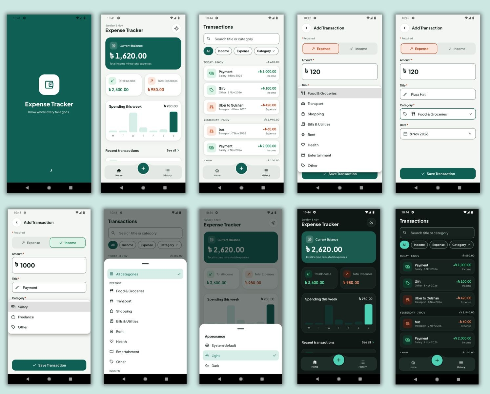

# Expense Tracker

A personal finance app built with Flutter for recording daily income and expenses.



## What it does

- **Splash screen** shown while saved transactions load, then fades into Home.
- **Dashboard** with Current Balance, Total Income and Total Expenses, a seven-day spending
  chart and the four most recent transactions.
- **Add a transaction** with title, amount, category, Income / Expense type and date.
  Invalid input is reported under the field it belongs to.
- **Transaction history** grouped by day (each day shows its net total), with search and
  filters for type and category.
- **Transaction details** with the full record, plus Edit and Delete.
- **Edit** reuses the Add form, pre-filled with the saved values.
- **Delete** asks for confirmation in an `AlertDialog` before removing anything.
- **Summaries update automatically** after every add, edit or delete.
- **Light, dark or system theme**, chosen from the button in the Home header. The choice is
  remembered.
- **Empty states** for no transactions, no search results and an empty history. Long titles
  are truncated in lists, and very large amounts are shortened to `Cr` / `L` in the small
  summary cards.

### Validation

| Field | Rule |
| --- | --- |
| Title | Must not be empty or only spaces |
| Amount | Must be a number greater than zero (up to two decimals) |
| Category | Must be selected; the list depends on Income or Expense |
| Type | Always set; Expense is preselected |
| Date | Defaults to today; future dates cannot be chosen |

## Local database

Transactions are stored with `sqflite` in `expense_tracker.db`, table `transactions`:

| Column | Type |
| --- | --- |
| `id` | `INTEGER PRIMARY KEY AUTOINCREMENT` |
| `title` | `TEXT` |
| `amount` | `REAL` |
| `category` | `TEXT` (enum name) |
| `type` | `TEXT` (`income` or `expense`) |
| `date` | `TEXT` (ISO-8601) |

The chosen theme is the only other stored value; it lives in shared preferences.

## Packages

| Package | Why it is used |
| --- | --- |
| `provider` | State management. Each screen's state is a `ChangeNotifier` (transactions, History filters, the Add / Edit form, theme, tab, splash) that widgets read with `watch` and `read`. Screens stay stateless. |
| `sqflite` | Required local database for the transactions. Gives real SQL queries, auto-increment ids and data that survives restarts. |
| `path` | Builds the database file path with `join`. |
| `shared_preferences` | Stores the single theme setting, which is too small to need a table. |
| `google_fonts` | Loads Plus Jakarta Sans for the UI and Noto Sans Bengali, which supplies the ৳ glyph that the main font lacks. |
| `cupertino_icons` | Default Flutter dependency; icons used come from Material. |
| `flutter_lints` (dev) | Static analysis rules. |
| `flutter_test` (dev) | Unit tests for formatters, summary maths and History filtering. |

## Architecture

The app uses three layers, and dependencies point inward: presentation depends on domain,
data depends on domain, and domain depends on nothing else.

- **`domain`** holds the entities, repository contracts and use cases. It is plain Dart with
  no Flutter and no database code.
- **`data`** implements those contracts with SQLite and shared preferences.
- **`presentation`** holds screens, widgets and controllers.
- **`core`** holds shared tokens and helpers: colours, strings, spacing, theme and formatters.

Project rules followed throughout: one class per file, all user-facing text in
`AppStrings`, all colours in `AppColors`, and no literal text or colours in `presentation`.

### File route

```
lib/
├── main.dart                         Entry point: opens storage and starts the app
├── app.dart                          Providers, MaterialApp, themes, splash as home
│
├── core/
│   ├── constants/
│   │   └── app_strings.dart          Every static string shown to the user
│   ├── theme/
│   │   ├── app_colors.dart           Light and dark colour tokens (ThemeExtension)
│   │   ├── app_colors_context.dart   context.colors shortcut
│   │   ├── app_radius.dart           Corner radii
│   │   ├── app_spacing.dart          Spacing and fixed sizes
│   │   └── app_theme.dart            ThemeData and the type scale
│   └── utils/
│       ├── date_formatter.dart       7 Nov 2026, Today · 7 Nov, ...
│       └── money_formatter.dart      ৳ grouping and Cr / L shortening
│
├── domain/
│   ├── entities/                     TransactionEntity, TransactionType, Category,
│   │                                 TransactionSummary, AppThemeMode
│   ├── repositories/                 TransactionRepository, ThemePreferenceRepository
│   └── usecases/                     Get / Add / Update / DeleteTransaction,
│                                     CalculateSummary, CalculateWeeklySpending
│
├── data/
│   ├── local/
│   │   └── database_helper.dart      Opens expense_tracker.db, creates the table
│   ├── models/
│   │   └── transaction_model.dart    Table row <-> entity
│   ├── datasources/                  transaction_local_data_source (SQL),
│   │                                 theme_local_data_source (preferences)
│   └── repositories/                 Implementations of the domain contracts
│
└── presentation/
    ├── navigation/
    │   └── app_navigator.dart        All route changes in one place
    ├── state/                        Provider controllers
    │   ├── transaction_controller    Loaded transactions, summary, add / update / delete
    │   ├── transaction_form_controller  Add / Edit form state and validation
    │   ├── history_controller        Search text and filters
    │   ├── shell_controller          Selected bottom-bar tab
    │   ├── theme_controller          System / light / dark
    │   └── splash_controller         Load data, then leave the splash
    ├── screens/
    │   ├── splash_screen.dart
    │   ├── app_shell.dart            Tabs, bottom bar and the Add button
    │   ├── home_screen.dart
    │   ├── history_screen.dart
    │   ├── add_edit_transaction_screen.dart
    │   └── transaction_details_screen.dart
    └── widgets/                      Reusable pieces (cards, fields, buttons, dialogs,
                                      sheets, bottom bar, empty state, ...)

test/
└── widget_test.dart                  Formatter, summary, weekly spending and filter tests
```

## Design

The visuals follow a small design system: a deep teal brand colour, green for income and
burnt orange-red for expense, and a notched bottom bar with a floating Add button. Income
and expense are never told apart by colour alone; each also has a sign (`+` / `−`), an arrow
and a label, so the app stays readable for colour-blind users. Light and dark themes both
keep text at WCAG AA contrast.
